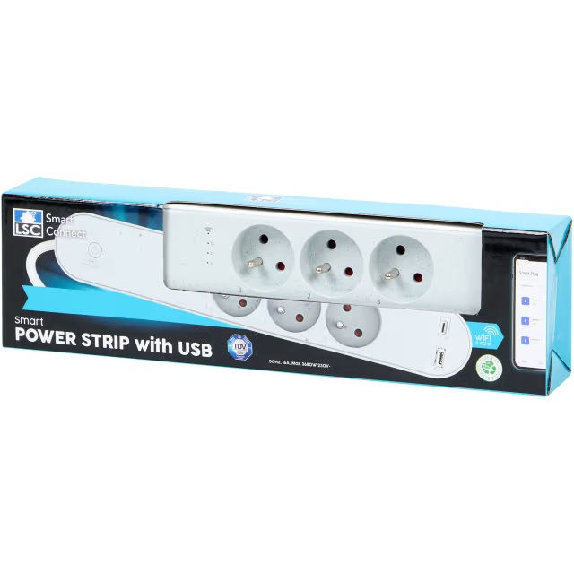

# LSC 3211133 Power Strip with USB

## Overview

The **LSC 3211133 Power Strip with USB** is a Wi-Fi smart power strip designed, sold by Action (https://www.action.com/fr-fr/p/3211133/multiprise-connectee-lsc-smart-connect/).

## Features

### Power Outlets
- **3 x French Standard Outlets**: Individually controllable with a maximum power rating of 3680W (total).
- **1 x USB-A Port**: 5.0VDC 3.0A (max 15.0W); 9.0VDC 2.0A (max 18.0W); 12.0VDC 1.5A (max 18.0W).
- **1 x USB-C Port**: 5.0VDC 3.0A (max 15.0W); 9.0VDC 2.2A (max 20.0W); 12.0VDC 1.67A (max 20.0W).

**Note**: The combined maximum output for USB-A and USB-C ports is 5.0VDC 3.4A (max  17.0W).

### Connectivity
- **Wi-Fi Standard**: IEEE 802.11 b/g/n (2.4GHz only).
- **Remote Control**: Manage each outlet individually via LSC Smart Connect app or Tuya Smart app.

## Documentation

### Board

[CBU](https://developer.tuya.com/en/docs/iot/cbu-module-datasheet?id=Ka07pykl5dk4u) with chip BK7231N

### Pinout

### Scheduled Cycle

This feature use a base64 encoded payload to configure the scheduled cycle, for more details look at [cycle_time/README.md](cycle_time/README.md).
